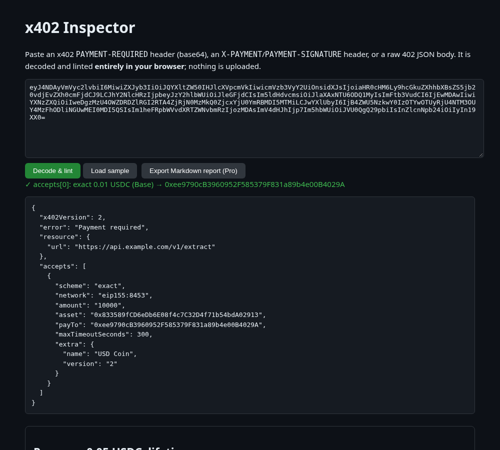

# x402 Inspector

**Live:** https://dansgit2b.github.io/x402-inspector/

This browser tool decodes and lints [x402](https://www.x402.org/) payment headers: `PAYMENT-REQUIRED` (base64 or JSON 402 bodies), `X-PAYMENT` / `PAYMENT-SIGNATURE` payloads, and `PAYMENT-RESPONSE` settlement receipts. It's handy when you're building or debugging a pay-per-call API or an agent that pays for one.

- Decodes v1 and v2 payloads and shows USDC amounts in human units.
- Flags missing fields, non-CAIP-2 networks in v2, malformed `payTo`, non-integer amounts, missing EIP-712 `extra`, and expired EIP-3009 authorizations.
- Everything runs locally as a static page, with no backend and no tracking.

**Try it:** open the page and click *Load sample*, or paste the `PAYMENT-REQUIRED` header from any 402 response (`curl -si https://your-api/endpoint | grep -i payment-required`).

## Pro pass (0.05 USDC)
Decoding and linting are free. A one-time 0.05 USDC pass unlocks **batch mode** and **Markdown report export**. You pay in USDC on Base or Arc straight to the Lumen Works wallet `0xee9790cB3960952F585379F831a89b4e00B4029A`, and the page checks the transaction on-chain. Since the code is MIT you could remove the check yourself; the pass is a fair way to fund upkeep.

## Run locally
Open `docs/index.html`. There's no build step.

## More from Lumen Works
- [x402 Inspector](https://dansgit2b.github.io/x402-inspector/): decode and lint x402 payment headers ([repo](https://github.com/Dansgit2b/x402-inspector))
- [EIP-712 Inspector](https://dansgit2b.github.io/eip712-inspector/): see what a typed-data signature authorises, with hashes and signer recovery ([repo](https://github.com/Dansgit2b/eip712-inspector))
- [Calldata Decoder](https://dansgit2b.github.io/calldata-decoder/): decode EVM calldata and multicalls without an ABI, with risk flags ([repo](https://github.com/Dansgit2b/calldata-decoder))
- [Lumen Tab](https://dansgit2b.github.io/lumen-tab/): pay-as-you-go micropayment tabs for agents on Arc ([repo](https://github.com/Dansgit2b/lumen-tab))

MIT © Lumen Works. Not affiliated with Coinbase or the x402 Foundation.

## Support this project

This tool is free and MIT-licensed, maintained by one developer. If it saved you time, a tip of any size keeps it maintained:

- **USDC on Base or Arc:** `0xee9790cB3960952F585379F831a89b4e00B4029A`
- Drips: this repo has a `FUNDING.json`, so it can receive funds and dependency splits through [Drips](https://www.drips.network/).

Thank you!
